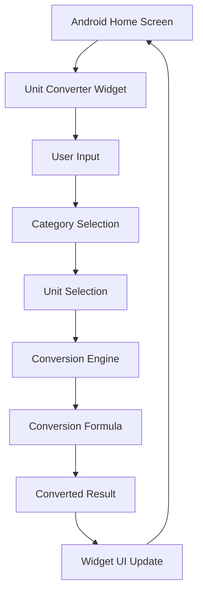
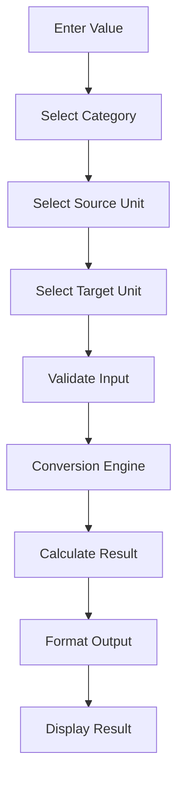

# 🔄 UnitConverterWidget

**Convert units quickly. Simplify everyday calculations.**

UnitConverterWidget is an Android utility widget designed to make unit conversions convenient and accessible.

It aims to reduce the effort required for everyday conversions by providing a simple interface where users can select measurement categories, enter values, and obtain converted results.

## ✨ Features

- 🔢 Quick unit conversion.
- 📏 Multiple measurement categories.
- ⚡ Fast conversion calculations.
- 🏠 Home screen widget experience.
- 🎯 Simple and accessible interface.
- 🔄 Easy switching between units.

## 🏗️ Architecture

UnitConverterWidget follows a modular architecture that separates the widget presentation from the conversion engine.

The conversion engine handles calculations independently, making it easier to introduce additional measurement categories without changing the entire widget implementation.

### High-Level Architecture



### Component Responsibilities

| Component | Responsibility |
|---|---|
| Widget UI | Displays conversion controls |
| Input Handler | Receives numerical values |
| Category Manager | Handles measurement categories |
| Unit Manager | Handles available units |
| Conversion Engine | Performs conversion calculations |
| Result Handler | Formats and displays results |

## ⚙️ Core Application Logic

### 1. Unit Conversion Workflow



### 2. Conversion Logic

The conversion engine is responsible for translating a value from one unit into another.

For units belonging to the same measurement category, a common base-unit approach can simplify calculations.

For example:

- Convert the input value into a base unit.
- Convert the base-unit value into the target unit.
- Return the formatted result.

A generalized conversion formula is:

\[
\text{Result} =
\frac{\text{Input} \times \text{Source Factor}}
{\text{Target Factor}}
\]

This formula applies to compatible linear unit conversions when both factors use the same base unit.

### 3. Example Conversion

For length:

```text
Input: 5
From: Kilometer
To: Meter

Calculation:
5 × 1000 = 5000

Result:
5000 Meters
```

Temperature conversions require separate formulas because temperature scales use different offsets.

For example:

\[
F = \frac{9}{5}C + 32
\]

\[
C = \frac{5}{9}(F - 32)
\]

Keeping conversion logic separate from the widget UI makes the calculation engine easier to test and maintain.

## 📂 Suggested Project Structure

```text
UnitConverterWidget/
├── app/
│   └── src/
│       └── main/
│           ├── java/
│           │   └── com/example/unitconverterwidget/
│           │       ├── ui/
│           │       ├── widget/
│           │       ├── converter/
│           │       ├── models/
│           │       ├── utils/
│           │       └── data/
│           │
│           ├── res/
│           │   ├── drawable/
│           │   ├── values/
│           │   └── xml/
│           │
│           └── AndroidManifest.xml
│
├── build.gradle.kts
├── settings.gradle.kts
└── README.md
```

*This is a suggested organization; retain the actual structure of your implementation.*

## 🛠️ Technology Stack

- Android Development.
- Kotlin (if used in the current implementation).
- Android App Widgets.
- Android Studio.
- Mathematical conversion algorithms.

## 🚀 Getting Started

### Prerequisites

- Android Studio.
- Android SDK.
- Compatible JDK.
- Git.

### Installation

1. Clone the repository.

```bash
git clone YOUR_REPOSITORY_URL
```

2. Open the project in Android Studio.
3. Sync Gradle dependencies.
4. Build and install the application.
5. Add UnitConverterWidget to your Android home screen.
6. Select a measurement category and start converting.

## 📸 Screenshots

```markdown


```

## 🔮 Future Improvements

- Additional measurement categories.
- Conversion history.
- Favorite conversions.
- Custom unit support.
- Improved number formatting.
- More advanced conversion options.

## 🤝 Contributing

Contributions, bug reports, and feature suggestions are welcome.

## 📄 License

Add your chosen open-source license if applicable.
